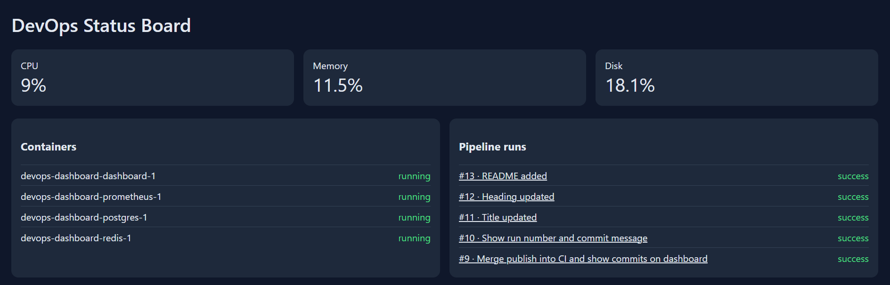
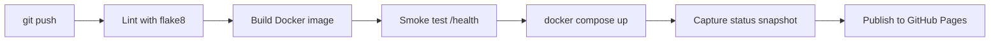

# DevOps Status Dashboard

[](https://github.com/britideepabrahma/devops-dashboard/actions/workflows/ci.yml)

A containerized monitoring dashboard that shows **Docker container status**, **host metrics**, and **CI pipeline runs** in one place, with a GitHub Actions pipeline that lints, builds, tests, and publishes a live status page on every commit.

**Live demo:** https://britideepabrahma.github.io/devops-dashboard/



## Features

- **Container status**: lists the stack's containers and their state (running, exited) via the Docker Engine API
- **System metrics**: CPU, memory, and disk usage via `psutil`
- **Pipeline runs**: latest GitHub Actions runs with commit messages and results
- **Prometheus metrics**: `/metrics` endpoint scraped by a bundled Prometheus instance
- **Health check**: `/health` endpoint used by Docker `HEALTHCHECK` and the CI smoke test

## Architecture



The Flask app reads container data from the Docker socket and pipeline data from the GitHub API. On every push to `main`, the CI pipeline starts the full Docker Compose stack on the runner, collects a snapshot through the app's own API, and publishes it as a static page, so the public demo needs no server.

## Tech stack

| Area | Tools |
|------|-------|
| Application | Python, Flask, Gunicorn |
| Containers | Docker, Docker Compose |
| Monitoring | Prometheus, prometheus-client, psutil |
| CI/CD | GitHub Actions, GitHub Pages |
| Code quality | flake8 (PEP 8) |

## Run locally

Requirements: Docker and Docker Compose.

```bash
git clone https://github.com/britideepabrahma/devops-dashboard.git
cd devops-dashboard
docker compose up --build
```

- Dashboard: http://localhost:5000
- Prometheus: http://localhost:9090

Try stopping a container and watch the dashboard update within a few seconds:

```bash
docker stop devops-dashboard-redis-1
docker start devops-dashboard-redis-1
```

## API endpoints

| Endpoint | Description |
|----------|-------------|
| `/api/system` | CPU, memory, disk usage, uptime |
| `/api/containers` | Containers in this Compose project and their status |
| `/api/pipelines` | Latest GitHub Actions runs |
| `/health` | Health check |
| `/metrics` | Prometheus metrics |

## Project structure

```
devops-dashboard/
├── app.py                    # Flask app and API
├── templates/index.html      # Local live dashboard
├── static/index.html         # Public GitHub Pages dashboard
├── Dockerfile
├── docker-compose.yml        # App, Postgres, Redis, Prometheus
├── prometheus.yml
└── .github/workflows/ci.yml  # Lint, build, test, publish
```

## Design notes and trade-offs

- **Docker socket access**: the dashboard mounts `/var/run/docker.sock` read-only to read container status. This grants significant access to the host, which is acceptable for a local demo but would need a restricted proxy (such as a Docker socket proxy) in production.
- **Static public page**: GitHub Pages can only serve static files, so the public page shows a snapshot of the stack from the latest CI run, while pipeline runs are fetched live in the browser.
- **Metrics scope**: CPU, memory, and disk values describe the machine running the containers (the CI runner on the public page, or the Docker VM locally).

## Possible improvements

- Grafana dashboard on top of Prometheus
- Alerting rules for container restarts and high resource usage
- Deployment to a cloud VM or Kubernetes cluster
- Push the image to GitHub Container Registry